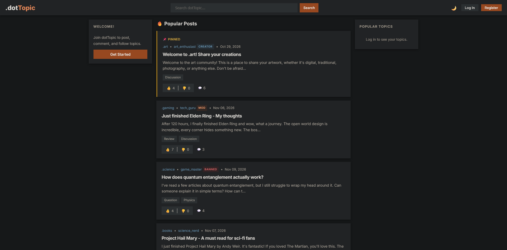

# dotTopic

A lightweight, Reddit-inspired community forum web application built with Flask and Vanilla JavaScript/jQuery.

> **Note:** Developed as a university project for Web Application Development (CSCI315, 2026). Published here for archival and portfolio purposes.


## Screenshot




## Technologies Used
- **Backend:** Python 3, Flask (Application Factory & Blueprints pattern), Flask-Login, Werkzeug (Password Hashing)
- **Database:** SQLite via SQLAlchemy ORM
- **Templating:** Jinja2 (Template inheritance, modular partials & modals)
- **Frontend:** Vanilla HTML5, CSS3 (Custom properties, flexbox/grid layout), JavaScript & jQuery (DOM manipulation, AJAX requests)


## Features
- **Authentication & Accounts:** User registration, session-based login with Flask-Login, account settings (update username, email, password, and custom avatar).
- **Hierarchical Permissions:** Granular roles including Super Admin, Topic Creators, Topic Moderators, and regular Subscribers.
- **Topics (Communities):** Create custom topics, subscribe/follow feeds, assign moderators, manage topic tags, and moderate communities (ban/unban users).
- **Posts & Media:** Create rich posts with multi-tag categorization and image/video uploads, edit existing posts, and pin announcements.
- **Threaded Discussions:** 2-level nested comment threads with real-time posting and editing.
- **Dynamic Voting:** Upvote/downvote system for both posts and comments with live score updates via AJAX.
- **Content Discovery:** Toggle between a personalized "Subscribed Feed" and a randomized discovery feed, plus keyword-based search across topics and post titles/bodies.


## Project Structure & File Overview

```text
dottopic/
│
├── app.py              # Application entry point & factory (create_app); initializes extensions, blueprints, and DB tables
├── config.py           # Centralized configuration (secret key, database URI, upload paths, file size limits)
├── models.py           # SQLAlchemy database models (User, Topic, Post, Comment, LikeDislike, Tag, Subscription, etc.)
├── seed.py             # Database seeding script for mock development data
├── requirements.txt    # Python package dependencies
├── DOCS.md             # Detailed technical documentation (data models, relationships, and request cycles)
├── screenshots/        # Application interface previews
│
├── routes/             # Modular Flask blueprints
│   ├── auth.py         # Login, registration, logout, and account management routes
│   ├── main.py         # Home feed (subscribed vs. random) and search routes
│   ├── topics.py       # Topic creation, post viewing, post submission, tag management, and file uploads
│   ├── users.py        # Public user profiles and settings handlers
│   └── api.py          # RESTful JSON endpoints powering AJAX features (voting, inline comments, bans, pins)
│
├── templates/          # Jinja2 HTML templates
│   ├── base.html       # Global layout containing header navigation, flash alerts, and shared modals
│   ├── home.html       # Main landing feed
│   ├── topic.html      # Individual topic page listing topic posts and moderation actions
│   ├── post_detail.html# Full post view with threaded comment section
│   ├── user.html       # Public user profile showing authored posts
│   ├── create_topic.html# Form for starting a new community topic
│   ├── search.html     # Search results for topics and posts
│   └── partials/       # Reusable UI components (post cards, comment threads, alert/confirm/login modals)
│
└── static/             # Static assets
    ├── css/            # Modular stylesheets (style.css, modals.css)
    ├── js/             # Client-side scripts (main.js, like-system.js, modal-handler.js, subscribe.js)
    ├── default_*.png   # Fallback avatar, topic icon, and banner images
    └── uploads/        # Directory storing user-uploaded media (profile pictures and post media)
```

### Deep Dive: `seed.py`
The `seed.py` script quickly populates an empty SQLite database with a realistic, fully interactive dataset for demonstration and testing. When executed:
1. **Database Reset:** Drops existing database tables and rebuilds the schema clean.
2. **User Accounts:** Creates 8 demo user profiles with pre-hashed passwords:
   - 1 Super Admin (`admin`)
   - 7 themed user personas (`tech_guru`, `game_master`, `movie_buff`, `book_worm`, `music_lover`, `art_enthusiast`, `science_nerd`).
3. **Topics & Communities:** Sets up 6 pre-populated topics (`.gaming`, `.movies`, `.books`, `.music`, `.art`, `.science`), each initialized with relevant tag sets, assigned creator accounts, and initial subscribers.
4. **Posts & Media:** Creates discussions, reviews, and announcements across the topics, including pinned guidelines and sample media attachments.
5. **Threaded Comments:** Seeds multi-level conversational comment threads to demonstrate the 2-level reply hierarchy.
6. **Votes & Moderation:** Simulates realistic like/dislike vote tallies across posts and comments, assigns moderators, and sets up sample moderation states (such as a banned user record in `.science`).


## Setup & Running Locally

### 1. Clone the repository & create a virtual environment
```bash
git clone https://github.com/your-username/dottopic.git
cd dottopic

# Create a virtual environment
python -m venv venv

# Activate the virtual environment:
# On Windows:
venv\Scripts\activate
# On macOS/Linux:
source venv/bin/activate
```

### 2. Install dependencies
```bash
pip install -r requirements.txt
```

### 3. (Optional) Seed demo data
To populate the database with sample topics, posts, comments, and test users:
```bash
python seed.py
```

### 4. Run the application
```bash
python app.py
```

Open your browser and navigate to:
**[http://127.0.0.1:5001](http://127.0.0.1:5001)** *(or `http://localhost:5001`)*


## Default Accounts

### Super Admin Account
The default Super Admin account is pre-configured and seeded on initial run:
- **Username:** `admin`
- **Password:** `admin123`

*(Can also be customized via `SUPER_ADMIN_USERNAME` and `SUPER_ADMIN_PASSWORD` environment variables in `config.py`)*

### Seeded Demo Users (from `seed.py`)
- **Usernames:** `tech_guru`, `game_master`, `movie_buff`, `book_worm`, `music_lover`, `art_enthusiast`, `science_nerd`
- **Password:** `password123`


## Additional Documentation
For in-depth architectural details, database schema relationship diagrams, and client-server request flows, refer to [DOCS.md](DOCS.md).


## Authors & Credits
Ali Fadlallah & Hadi Ismail
